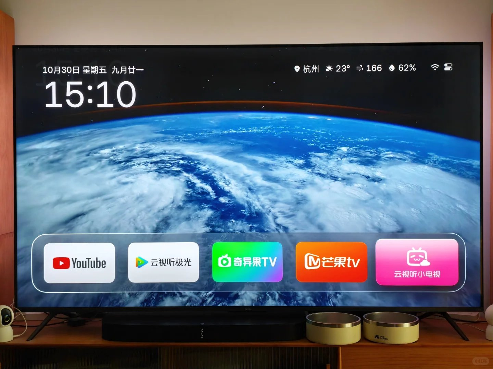

<div align="center">

# HLine TV

**干干净净的电视桌面**

开机看到的第一眼，没有广告，没有推荐位，没有会员角标。<br>
只有时间、天气、你的 App，和一张会动的壁纸。<br>
装在普通的安卓电视上，看起来像 Apple TV。

[](https://github.com/Harleyline/hline-tv/releases/latest)
[](https://github.com/Harleyline/hline-tv/releases/latest)

[](LICENSE)



</div>

## 功能

- **干净的首页**：常用的一排 App 放在屏幕下方的玻璃底板上，往下是全部 App；长按 OK 键可以移动、建文件夹、隐藏、卸载，或设为「开机时打开」。小米「应用中心」「米家」这类藏起来的系统 App 也在。
- **用手机整理**：扫电视上的二维码，手机上就是和电视一样的图标网格——拖动排序、改名、换图标、发照片和视频，都在手机上完成。
- **壁纸**：内置五张照片壁纸（沙丘两张、浪一张、城市两张），也可以发自己的照片、用必应每日一图，或跟随当前 App 的配色。
- **航拍屏保**：闲置后自动播放航拍影片，画面上有时钟和地名，电视支持时播 4K 或 4K 杜比视界；也可以选「壁纸」或纯「时钟」。
- **信号源**：HDMI 输入可以固定到桌面，开机直接进机顶盒或游戏机，图标和名字都能改。
- **贴心的小事**：控制中心（信号源、网络、音量、亮度、个性化）、焦点音、家长密码、自动睡眠、多语言（中/繁/英/日/韩/俄/乌/哈萨克/法/蒙等）。

## 其他语言

**English**　A home screen with nothing to sell you.<br>
The first thing you see when the TV comes on: no ads, no sponsored rows, no membership badges. Just the time, the weather, your apps, and a wallpaper that moves.<br>
Installed on a plain Android TV, it looks like an Apple TV.

**日本語**　売り込みのないホーム画面。<br>
電源を入れて最初に見えるのは、広告でも、おすすめ欄でも、会員バッジでもありません。時刻と天気、自分のアプリ、そして動く壁紙だけ。<br>
ごく普通の Android テレビが、Apple TV のように見えます。

**한국어**　광고가 없는 홈 화면.<br>
TV를 켜면 가장 먼저 보이는 것은 광고도, 추천 목록도, 멤버십 배지도 아닙니다. 시계와 날씨, 내 앱, 그리고 움직이는 배경화면뿐입니다.<br>
평범한 Android TV에서도 Apple TV처럼 보입니다.

**Русский**　Главный экран, на котором ничего не продают.<br>
При включении телевизора вы не увидите ни рекламы, ни рекомендаций, ни значков подписки. Только время, погода, ваши приложения и живой фон.<br>
На обычном Android-телевизоре он выглядит как Apple TV.

## 下载安装

不用 root，不动系统应用，随时能还原。电视和电脑（或手机）连同一个网络。

| 文件（在 [Releases](https://github.com/Harleyline/hline-tv/releases/latest) 页面） | 说明 |
|---|---|
| `aerial-standard.apk` | 标准版，Android 5.0 及以上，先试这个 |
| `aerial-guard.apk` | 标准版装不上时用（部分电视不允许安装桌面类应用） |
| `version.txt` | 最新版本号，供应用内「检查更新」读取，不用手动下载 |

每个版本改了什么，见 [CHANGELOG.md](CHANGELOG.md)。

**一键安装**：先在电视上打开 ADB 调试（见下表），然后电脑上执行（`TV` 换成电视的 IP）：

```bash
curl -fsSL https://raw.githubusercontent.com/Harleyline/hline-tv/main/tools/install.sh | TV=192.168.1.20 bash
```

**手动安装**：

```bash
adb connect 电视IP:5555
adb install aerial-standard.apk
```

装好后按系统提示把 HLine TV 设为默认桌面即可。

### 打开电视的 ADB 调试

| 电视 | 怎么打开 |
|---|---|
| **小米 / Redmi** | 设置 → 关于 → 连续按「产品型号/产品类型」进入开发者模式，再到 设置 → 账号与安全，打开「ADB 调试」和「安装未知来源的应用」 |
| **TCL / 雷鸟** | 设置 → 关于 → 本机信息，快速按遥控器「上下左右」，在底部的「更多」里打开 ADB |
| **海尔 / 模卡** | 按电视机身上的信号源键，再用遥控器按「左左上右」，在工厂菜单里打开「ADB 调试开关」，别动其他选项 |
| **OPPO（含 S1）** | 设置 → 系统 → 关于本机 → 设备型号，按「上上右右」再按确认；再到 设置 → 系统 → 开发者选项，打开「USB 调试」 |
| **其他 Android TV** | 设置 → 设备偏好设置 → 关于 → 连按「内部版本号」7 次，再在开发者选项里打开「USB 调试」 |

电视的 IP 在「设置 → 网络 → 已连接的网络」里。第一次连接会问是否允许调试，选「始终允许」。只有「无线调试」的电视（Android 11+）要多一步配对，安装脚本会引导。

## 应用内更新

装好之后不用再来仓库下载：控制中心出现「新版本」时点「下载并安装」，应用会从本仓库的 Releases 拉取新 APK，App、排列顺序、壁纸和设置都会保留。

给维护者的发布流程：

1. 改 `app/build.gradle.kts` 里的 `versionCode` / `versionName`；
2. `./gradlew :app:assembleStandardRelease`（需要 `local/signing.properties` 里的签名密钥）；
3. 把 `app/build/outputs/apk/standard/release/app-standard-release.apk` 改名为 `aerial-standard.apk`，再写一个只有版本号的 `version.txt`（如 `1.1`）；
4. 在 GitHub 发布 Release（tag 如 `v1.1`），附上这两个文件。已装的电视几小时内会看到「新版本」。

## 构建

```bash
./gradlew :app:assembleStandardRelease
```

需要 JDK 17。签名密钥不在版本库里（`local/`，见 `docs/HANDOFF.md`）；没有密钥时构建会退回 debug 签名，可以全新安装，但不能覆盖升级已有安装。

## 致谢与许可

本项目基于 [Aerial](https://github.com/pengchujin/aerial-tv)（MIT，安装指南改编自其文档）构建，感谢原作者与所有贡献者。第三方素材与许可见 [CREDITS.md](CREDITS.md)：字体（SIL OFL）、城市数据（GeoNames, CC BY 4.0）、两张城市壁纸（Unsplash License）、必应每日一图，以及 Apple 的公开航拍影片（仅在线播放，不随应用分发）。

## 免责声明

HLine TV 是独立的个人项目，与 Apple、小米、索尼等公司无关。航拍影片来自 Apple 公开的流媒体地址，版权归 Apple 所有，本项目不存储、不再分发这些影片。请遵守你所在地区的法律法规使用本软件。
