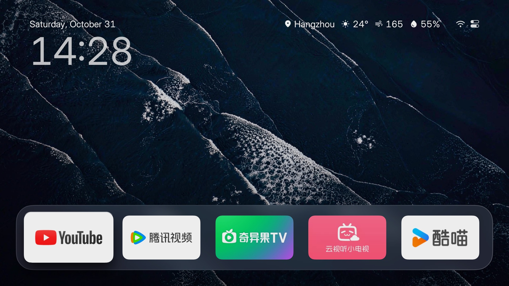
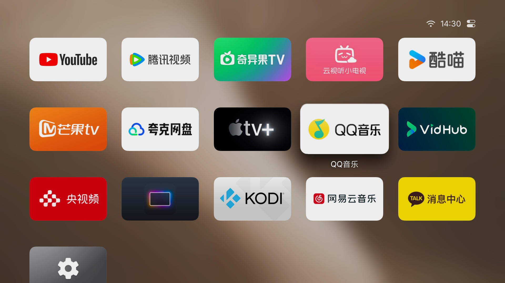

<div align="center">

# HLine TV

**A clean home screen for Android TV. Nothing on it is for sale.**

The first thing your TV shows when it wakes up: the time, the weather, your apps, and a wallpaper
that moves. No ads, no sponsored rows, no membership badges. Installed on a plain TV, it looks
like it cost a lot more than it did.

[](README.md) [](docs/i18n/zh-CN/README.md)

[](https://github.com/Harleyline/hline-tv/releases/latest)
[](https://hlinetv.com)
[](https://github.com/Harleyline/hline-tv/releases/latest)


[](LICENSE)







</div>

## Why people replace the stock launcher

|  | Most stock Android TV homes | HLine TV |
|---|---|---|
| Ads, sponsored rows, membership badges | Often there, rarely removable | None. There is nowhere to put them |
| A recommendation rail | Fixed | Doesn't exist |
| Reorder, rename, hide, uninstall apps | Partial, and only what the brand allows | Any app, plus folders and hidden apps |
| App icons | Fixed | Replace any icon, from your phone |
| Wallpaper | A fixed set | Five built in, your own photos, one new photo a day, or the colours of the app you're opening |
| Screensaver | Brand logo, or nothing | Aerial films with a clock and place names, 4K where the TV allows |
| Footprint | Dozens of processes | 11 MB, no background services |

## What you get

**A home screen with nothing to sell.** Your favourites sit on a glass shelf above the app grid.
Long-press OK to move them, put them in folders, hide them, uninstall them, or make one open at
boot. System apps the stock launcher keeps out of sight are here too.

**Change the layout from your phone.** Scan the QR code on the TV and the same grid opens in your
phone's browser: drag to reorder, rename, swap icons, and send photos or videos straight to the TV.
No account, no app to install on the phone. <!-- TODO(gif): phone page, drag + icon swap, <2 MB -->

**Wallpaper that isn't a stock photo.** Five built-in photographs (dunes, surf, city), your own
pictures and videos, one new photo a day, or a colour pulled from the app you're launching.

**A screensaver worth leaving on.** Aerial films over dunes and coastlines with the time and place
on screen; 4K, and Dolby Vision on TVs that support it. Or just the wallpaper, or just the clock.

**HDMI inputs become tiles.** Pin the set-top box or the console to the home screen, name it, give
it an icon, and open it with one press — the remote-shy members of the household will thank you.

**Small, and it runs on old TVs.** Android 5.0 and up, 11 MB, no always-on service. It boots on
the ten-year-old panel in the spare room as happily as on a new one.

## Install

No root. No system apps touched. Uninstall any time and the stock launcher is exactly as it was.

**One command.** Turn on ADB debugging on the TV (table below), then from your computer:

```bash
curl -fsSL https://raw.githubusercontent.com/Harleyline/hline-tv/main/tools/install.sh | TV=192.168.1.20 bash
```

**Or by hand:**

```bash
adb connect TV_IP:5555
adb install HLine-TV.apk
```

Then accept the prompt that offers HLine TV as the home app.

| File (on the [Releases](https://github.com/Harleyline/hline-tv/releases/latest) page) | What it is |
|---|---|
| `HLine-TV.apk` | Standard build, Android 5.0+. Try this one first |
| `HLine-TV-Guard.apk` | For TVs that refuse to install a launcher — same app, different package handling |
| `version.txt` | The version number, read by the in-app updater. You don't need it |

### Turning on ADB debugging

| TV | How |
|---|---|
| **Xiaomi / Redmi** | Settings → About → press the product model repeatedly to unlock Developer mode, then Settings → Account & Security → enable ADB debugging and installing from unknown sources |
| **TCL / FFALCON** | Settings → About → System info, then press Up/Down/Left/Right on the remote; enable ADB under "More" at the bottom |
| **Hisense / Vidaa** | Settings → About → press the build number seven times, then enable USB debugging in Developer options |
| **Sony BRAVIA** | Settings → About → press the build number seven times → Developer options → USB debugging. Models from 2021 on often offer wireless debugging only, which needs pairing first — see [sony-bravia.md](docs/devices/sony-bravia.md) |
| **Others** | Settings → Device preferences → About → press the build number seven times → Developer options → USB debugging |

The TV's IP address is under Settings → Network. The first connection asks whether to allow
debugging: choose "always allow". TVs with wireless debugging only need one extra pairing step,
and the install script walks you through it.

## Tested on

Twenty-seven models, documented one by one in [docs/devices](docs/devices) — what the ADB menu is
called on each, what breaks, and what to do about it.

| Brand | Models |
|---|---|
| Xiaomi / Redmi | [MFFU0](docs/devices/xiaomi-mitv-mffu0.md) · [MFTP0](docs/devices/xiaomi-mitv-mftp0.md) · [MFTR0](docs/devices/xiaomi-mitv-mftr0.md) · [MTSU0](docs/devices/xiaomi-mitv-mtsu0.md) · [NSOP0](docs/devices/xiaomi-mitv-nsop0.md) · [Android 6](docs/devices/xiaomi-android6.md) · [projector](docs/devices/xiaomi-ultraman-projector.md) |
| TCL / FFALCON | [M7221](docs/devices/tcl-m7221-cn.md) · [MT5879](docs/devices/tcl-mt5879-cn.md) · [MT9655](docs/devices/tcl-mt9655-cn.md) · [T966D5](docs/devices/ffalcon-t966d5.md) |
| Skyworth | [E900V21F](docs/devices/skyworth-e900v21f.md) · [P3 box](docs/devices/skyworth-p3-box.md) · [Coocaa](docs/devices/skyworth-coocaa.md) |
| Hisense | [Vidaa](docs/devices/hisense-vidaa.md) |
| Sony | [BRAVIA](docs/devices/sony-bravia.md) |
| OPPO | [ColorOS TV](docs/devices/oppo-coloros-tv.md) |
| Konka / Letv | [KKTV U86V9](docs/devices/konka-kktv-u86v9.md) · [X3-65](docs/devices/letv-x3-65.md) |
| Projectors | [H3](docs/devices/xgimi-h3.md) · [XK03U](docs/devices/xgimi-xk03u-android8.md) · [Z7X](docs/devices/xgimi-z7x.md) · [R3 Ultra](docs/devices/obe-r3-ultra.md) · [X7](docs/devices/obe-x7.md) |
| Boxes | [CM311-1](docs/devices/cm311-1-android9-atv.md) · [Tencent Aurora](docs/devices/tencent-aurora-box.md) |
| Any other | [ADB by brand](docs/devices/adb-by-brand.md) |

## Privacy

- No account, no sign-in, no analytics, no ad SDK.
- Nothing is collected and nothing is uploaded about you or what you watch.
- The network is used for four things only: the weather, one photo a day, the update check, and
  the aerial films. Turn the TV's network off and the home screen still works.
- It is a launcher, so it can see which app is in front — that is how the wallpaper follows the
  app's colours. It is not sent anywhere.

## Questions

**Will this brick my TV?** No. It installs as a normal app, nothing is written to the system
partition, and no root is involved.

**Do I lose the stock launcher?** No. It stays installed and can be chosen again.

**How do I go back?** Settings → Apps → HLine TV → uninstall, or pick the stock home in the
default-app settings.

**The APK won't install.** Some TVs block launcher apps by name. Use `HLine-TV-Guard.apk`.

**Do I need Google services?** No.

**Will it run on Android 5?** Yes — that is the minimum (API 21).

**Are there ads or tracking?** None of either.

**Can I use my own photos and videos?** Yes, from the phone page. Photos become wallpapers, videos
become the screensaver.

**Do updates keep my layout?** Yes — apps, order, wallpapers and settings all survive.

**Does it work with my language?** Fourteen interface languages: Chinese, Traditional Chinese,
English, Japanese, Korean, Russian, Ukrainian, Kazakh, German, Spanish, French, Portuguese, Arabic,
Thai.

## Updates

Installed once, updated from the TV: when the control centre offers a new version, tap
"Download and install". Everything is kept. Every build is on the
[Releases](https://github.com/Harleyline/hline-tv/releases) page, and
[CHANGELOG.md](CHANGELOG.md) has the details.

## Credits and licence

Thanks to everyone whose open work made this possible. Third-party assets and their licences are
listed in [CREDITS.md](CREDITS.md).

HLine TV is an independent personal project, not affiliated with Apple, Xiaomi, Sony or any other
company named here. The flyover films are streamed from publicly available addresses; this project
does not host or redistribute them. Please follow the laws of your country when using this
software.

MIT licensed.
