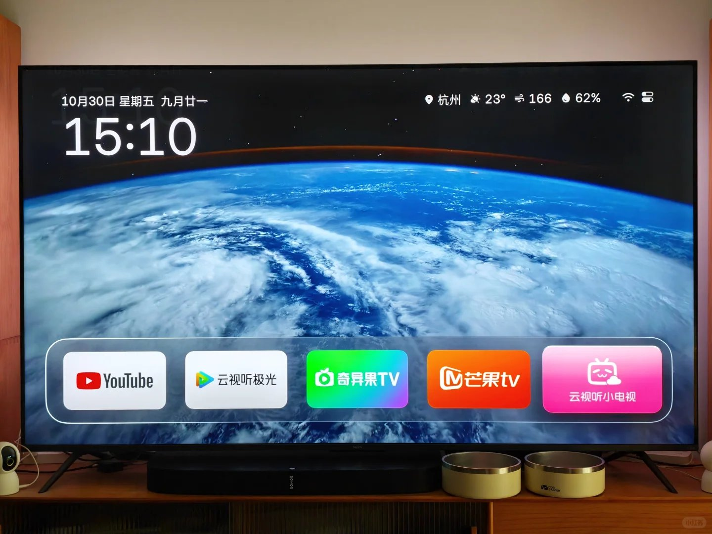
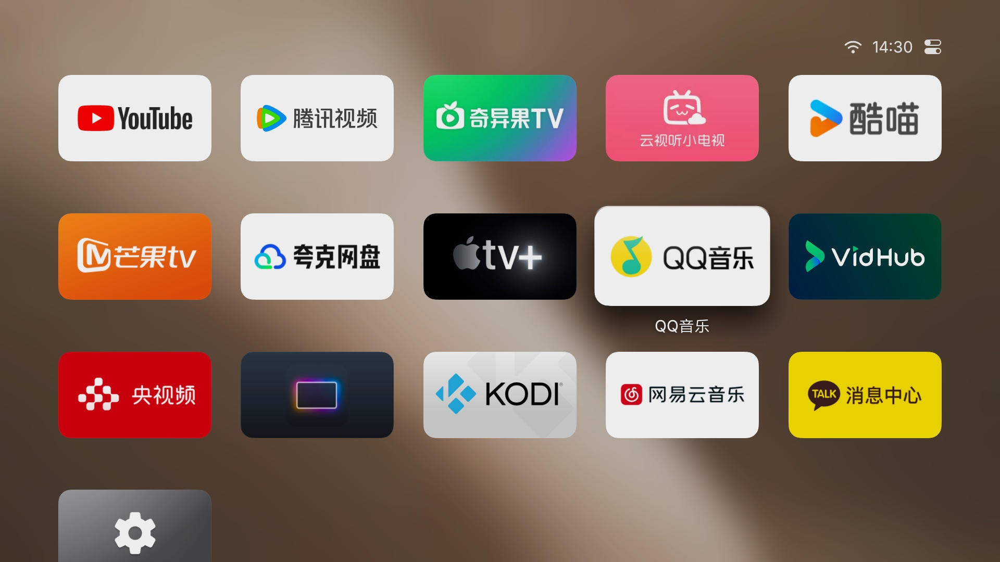
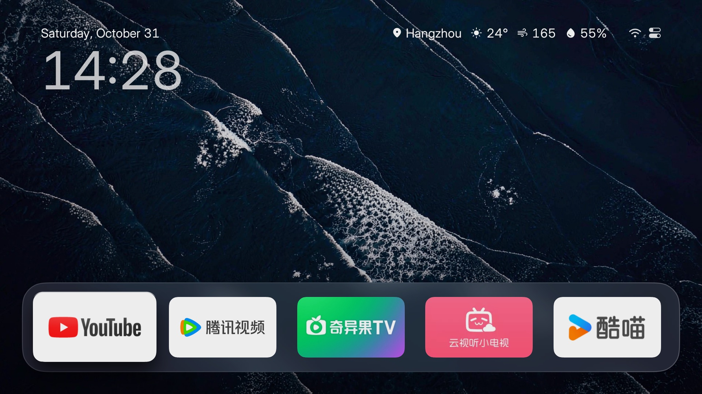

<div align="center">

# HLine TV

**一个干净的安卓电视桌面，上面没有一样东西是拿来卖的。**

电视亮起来的第一眼：时间、天气、你的 App，和一张会动的壁纸。没有广告，没有推荐位，没有会员
角标。装在普通的安卓电视上，看起来比它的价格贵得多。

[](../../../README.md) [](README.md)

[](https://github.com/Harleyline/hline-tv/releases/latest)
[](https://hlinetv.com)
[](https://github.com/Harleyline/hline-tv/releases/latest)


[](LICENSE)







</div>

## 为什么换掉原厂桌面

|  | 多数原厂安卓电视桌面 | HLine TV |
|---|---|---|
| 广告、推广位、会员角标 | 常有，且删不掉 | 没有，也没地方放 |
| 推荐流 | 固定，不可关 | 不存在 |
| 排序、改名、隐藏、卸载 App | 只在自己那套规则里能改 | 任何 App，还能建文件夹、隐藏 |
| 换图标 | 不能 | 任何 App 都能换，在手机上换 |
| 壁纸 | 固定几张 | 内置五张、你自己的照片、每天一张新图、或跟随当前 App 配色 |
| 屏保 | 品牌 Logo，或没有 | 航拍影片 + 时钟 + 地名，电视支持就上 4K |
| 占用 | 几十个进程 | 11 MB，没有后台常驻服务 |

## 你能得到什么

**一个不卖东西的首页。** 常用 App 放在 App 网格上方的玻璃底板上。长按 OK 键可以移动、建
文件夹、隐藏、卸载，或让它开机自动打开。原厂桌面藏起来的系统 App，这里也在。

**用手机改桌面。** 扫电视上的二维码，同一个图标网格就出现在手机浏览器里：拖动排序、改名、
换图标、把照片和视频直接发到电视。不用注册，手机上也不用装 App。 <!-- TODO(gif)：手机页，拖动 + 换图标，<2 MB -->

**壁纸不是图库里那几张。** 内置五张实拍（沙丘、浪、城市），也可以放自己的照片和视频、每天
换一张新图，或者跟着你要打开的 App 取色。

**一个值得一直开着的屏保。** 沙丘和海岸线的航拍影片，画面上有时间、有地名；支持的话播 4K，
甚至杜比视界。也可以只放壁纸，或者只要时钟。

**HDMI 变成一块磁贴。** 把机顶盒、游戏机钉在首页，改名字、给图标，按一下就进去——家里不
太会用遥控器的人会感谢你。

**小，而且老电视也跑得动。** Android 5.0 起，11 MB，没有常驻服务。十年前的老机器和新买的
一样能开机就用。

## 安装

不用 root，不动系统应用，随时卸载，原厂桌面原样还在。

**一条命令。** 先在电视上打开 ADB 调试（见下表），然后在电脑上：

```bash
curl -fsSL https://raw.githubusercontent.com/Harleyline/hline-tv/main/tools/install.sh | TV=192.168.1.20 bash
```

**或者手动：**

```bash
adb connect 电视IP:5555
adb install HLine-TV.apk
```

装好后按系统提示，把 HLine TV 选成桌面即可。

| 文件（在 [Releases](https://github.com/Harleyline/hline-tv/releases/latest) 页面） | 说明 |
|---|---|
| `HLine-TV.apk` | 标准版，Android 5.0 及以上，先试这个 |
| `HLine-TV-Guard.apk` | 电视不允许安装桌面类应用时用，功能一样，打包方式不同 |
| `version.txt` | 版本号，供应用内更新读取，不用手动下载 |

### 打开电视的 ADB 调试

| 电视 | 怎么打开 |
|---|---|
| **小米 / Redmi** | 设置 → 关于 → 连续按「产品型号」解锁开发者模式，再到 设置 → 账号与安全，打开「ADB 调试」和「安装未知来源的应用」 |
| **TCL / 雷鸟** | 设置 → 关于 → 本机信息，快速按遥控器「上下左右」，在底部的「更多」里打开 ADB |
| **海信 / VIDAA** | 设置 → 关于 → 连按版本号 7 次，再到开发者选项打开「USB 调试」 |
| **索尼 BRAVIA** | 设置 → 关于 → 连按「内部版本号」7 次 → 开发者选项 → USB 调试。2021 年后的机型多数只有「无线调试」，要先配对，见 [sony-bravia.md](../../devices/sony-bravia.md) |
| **其他安卓电视** | 设置 → 设备偏好设置 → 关于 → 连按「内部版本号」7 次 → 开发者选项 → USB 调试 |

电视的 IP 在 设置 → 网络 里。第一次连接会问是否允许调试，选「始终允许」。只有无线调试的
电视多一步配对，安装脚本会引导。

## 已适配机型

27 个机型，逐个记录在 [docs/devices](../../devices)：每台的 ADB 菜单叫什么、哪里会出问题、
怎么绕过去。

| 品牌 | 机型 |
|---|---|
| 小米 / Redmi | [MFFU0](../../devices/xiaomi-mitv-mffu0.md) · [MFTP0](../../devices/xiaomi-mitv-mftp0.md) · [MFTR0](../../devices/xiaomi-mitv-mftr0.md) · [MTSU0](../../devices/xiaomi-mitv-mtsu0.md) · [NSOP0](../../devices/xiaomi-mitv-nsop0.md) · [Android 6 机型](../../devices/xiaomi-android6.md) · [投影仪](../../devices/xiaomi-ultraman-projector.md) |
| TCL / 雷鸟 | [M7221](../../devices/tcl-m7221-cn.md) · [MT5879](../../devices/tcl-mt5879-cn.md) · [MT9655](../../devices/tcl-mt9655-cn.md) · [T966D5](../../devices/ffalcon-t966d5.md) |
| 创维 | [E900V21F](../../devices/skyworth-e900v21f.md) · [P3 盒子](../../devices/skyworth-p3-box.md) · [酷开](../../devices/skyworth-coocaa.md) |
| 海信 | [Vidaa](../../devices/hisense-vidaa.md) |
| 索尼 | [BRAVIA](../../devices/sony-bravia.md) |
| OPPO | [ColorOS TV](../../devices/oppo-coloros-tv.md) |
| 康佳 / 乐视 | [KKTV U86V9](../../devices/konka-kktv-u86v9.md) · [X3-65](../../devices/letv-x3-65.md) |
| 投影 | [H3](../../devices/xgimi-h3.md) · [XK03U](../../devices/xgimi-xk03u-android8.md) · [Z7X](../../devices/xgimi-z7x.md) · [R3 Ultra](../../devices/obe-r3-ultra.md) · [X7](../../devices/obe-x7.md) |
| 盒子 | [CM311-1](../../devices/cm311-1-android9-atv.md) · [腾讯极光](../../devices/tencent-aurora-box.md) |
| 其他 | [各品牌 ADB 汇总](../../devices/adb-by-brand.md) |

## 隐私

- 不用注册、不用登录，没有统计，也没有广告 SDK。
- 不采集任何东西，也不上传你在看什么。
- 联网只做四件事：天气、每天一张图、检查更新、航拍影片。把电视的网络关掉，桌面照样能用。
- 它是桌面，所以知道当前是哪个 App 在前台——壁纸跟随 App 配色靠的就是这个，这个信息不会发到
  任何地方。

## 常见问题

**会不会把电视刷坏？** 不会。它就是一个普通应用，不写系统分区，不用 root。

**原厂桌面会消失吗？** 不会，还在，随时能切回去。

**怎么回到原来的桌面？** 设置 → 应用 → HLine TV → 卸载；或在默认应用设置里重新选原厂桌面。

**APK 装不上怎么办？** 有些电视会拦桌面类应用，换用 `HLine-TV-Guard.apk`。

**需要谷歌服务吗？** 不需要。

**Android 5 能用吗？** 能，最低就是 Android 5.0（API 21）。

**有广告或数据采集吗？** 都没有。

**能用我自己的照片和视频吗？** 能，在手机页里传。照片当壁纸，视频当屏保。

**升级会丢桌面布局吗？** 不会，App、顺序、壁纸、设置都保留。

**支持我的语言吗？** 界面 14 种：简体中文、繁體中文、英语、日语、韩语、俄语、乌克兰语、哈萨克
语、德语、西班牙语、法语、葡萄牙语、阿拉伯语、泰语。

## 更新

装一次，之后在电视上更新：控制中心出现新版本时点「下载并安装」，所有设置都保留。每个版本都在
[Releases](https://github.com/Harleyline/hline-tv/releases) 页，改了什么见
[CHANGELOG.md](../../../CHANGELOG.md)。

## 致谢与许可

HLine TV 基于 Aerial（MIT）与 ClearYourTV 的思路构建，感谢原作者与贡献者。第三方素材与许可见
[CREDITS.md](../../../CREDITS.md)。

HLine TV 是独立的个人项目，与 Apple、小米、索尼等公司无关。航拍影片来自公开可用的流媒体地址，
本项目不存储、不再分发这些影片。请遵守你所在地区的法律法规使用本软件。

MIT 许可。
